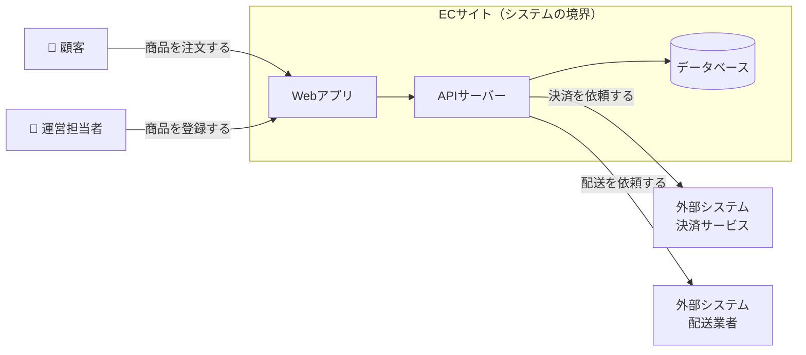
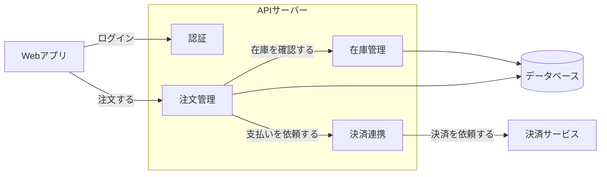
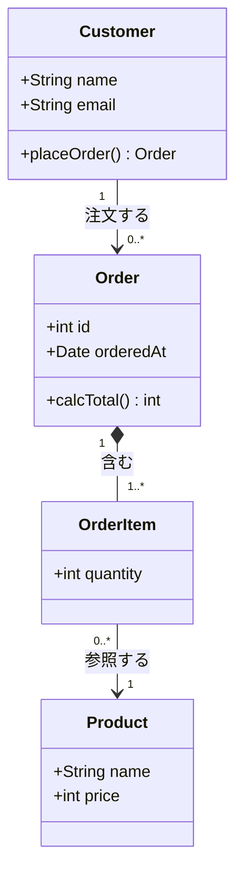
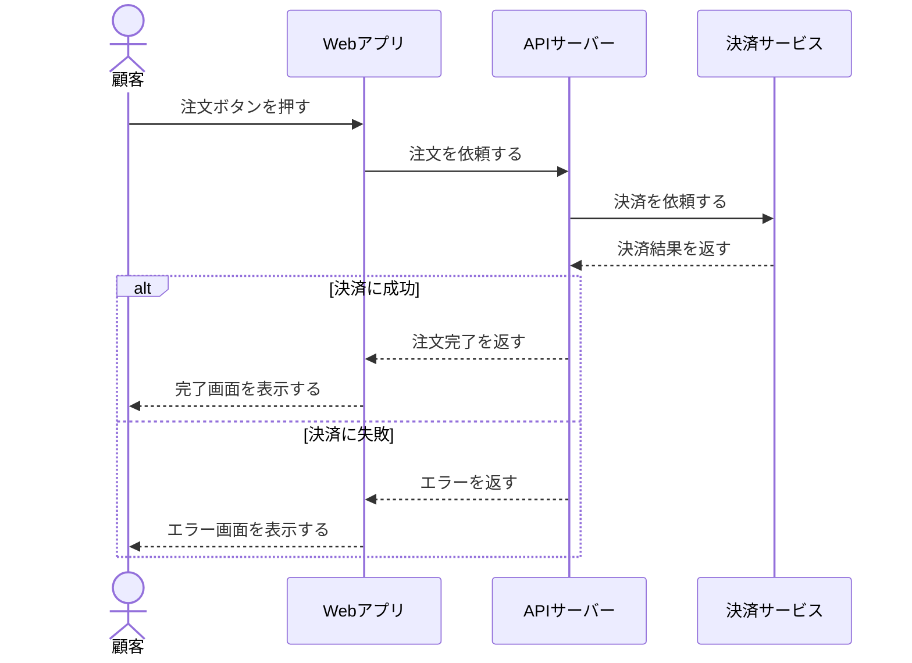
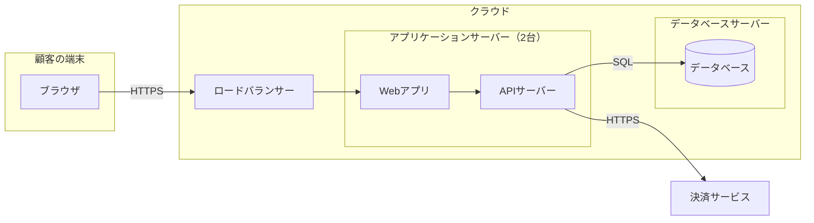
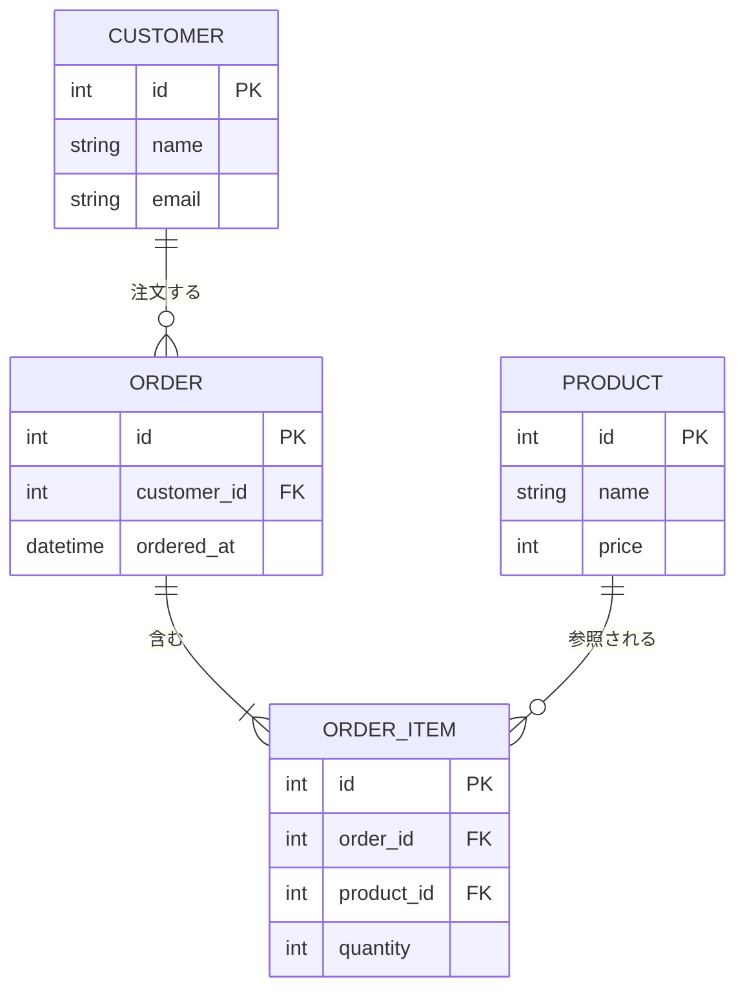
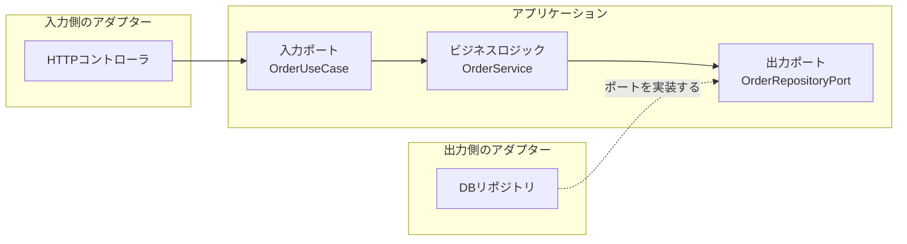

## 🌱 書籍情報
https://www.oreilly.co.jp/books/9784814401789/

## 🌱 本の概要
公式ページの紹介文を要約しています。

プログラミングの知識に加え、現場で求められる実践的なスキルを扱うガイド。既存コードの保守や改善、技術的負債への対応、設計とテスト、安定したリリース、チームやステークホルダーとのコミュニケーションなどを取り上げている。これから開発の仕事を始める人と、経験を積んでより広い視野と実務力を身につけたい開発者が対象。

## 🌱 読む目的
- 

## 🌱 読書メモ

### 📌 なぜ車輪の再発明は避けるべき？
- 自分が悩んだ悩みは他のプログラマーも同様に悩むことがある
- 自作メソッドを作成する前に、標準ライブラリーやテックブログを確認して、誰かが作成していないか確認する
- 既存のものを使えば、その分テストの実施のコストを軽減できる

### 📌 コンテキスト図とは？
- システム内のコンポーネント間の境界を定義する
- 有効な場面: 開発の初期に、システムの範囲と外部との関わり（誰が使い、どの外部システムとつながるか）を関係者で合意したいとき

以下は ECサイトを例にした簡易的なサンプル。



### 📌 コンポーネント図とは？
- システムがどのように連動しているのかを定義する
- 有効な場面: 機能の担当や依存関係を整理したいとき、変更したときの影響範囲を調べたいとき

以下は ECサイトを例にした簡易的なサンプル。



### 📌 クラス図とは？
- クラス同士がどのような関係性なのかを定義する
- 有効な場面: オブジェクト指向で設計するとき、クラスの責務や関係をチームで共有したいとき

以下は ECサイトを例にした簡易的なサンプル。



### 📌 シーケンス図とは？
- 相互のやりとりを定義する
- 有効な場面: 処理の流れや順序を確認したいとき、API連携や失敗時の分岐など時系列のやりとりを説明したいとき

以下は ECサイトの注文を例にした簡易的なサンプル。



### 📌 配置図とは？
- ハードウェアなどの関連性を定義する
- 有効な場面: サーバーやネットワークの構成を設計・共有したいとき、インフラ担当者と開発者で認識を合わせたいとき

以下は ECサイトを例にした簡易的なサンプル。



### 📌 データモデル図とは？
- データエンティティを定義する
- 有効な場面: データベースのテーブルを設計するとき、保存するデータとその関係を整理したいとき

以下は ECサイトを例にした簡易的なサンプル。



### 📌 テスト対象システム（SUT）とは？
- SUT（System Under Test）は、テストの対象となるシステムや関数、クラスのこと
- テストコードはSUTを呼び出し、結果が期待どおりかを確認する
- SUTが外部のAPIやデータベースに依存する場合は、モックなどの代役に置き換えてテストする

以下は、注文の合計金額を計算する関数 `calcTotal` をSUTにした簡易的なサンプル。

#### Jest（JavaScript）

```js:order.js
function calcTotal(items) {
  return items.reduce((sum, item) => sum + item.price * item.quantity, 0);
}

module.exports = { calcTotal };
```

```js:order.test.js
const { calcTotal } = require('./order');

describe('calcTotal', () => {
  test('明細の金額を合計する', () => {
    const items = [
      { price: 100, quantity: 2 },
      { price: 300, quantity: 1 },
    ];
    expect(calcTotal(items)).toBe(500);
  });

  test('明細が空のときは0を返す', () => {
    expect(calcTotal([])).toBe(0);
  });
});
```

#### pytest（Python）

```python:order.py
def calc_total(items):
    return sum(item["price"] * item["quantity"] for item in items)
```

```python:test_order.py
from order import calc_total


def test_明細の金額を合計する():
    items = [
        {"price": 100, "quantity": 2},
        {"price": 300, "quantity": 1},
    ]
    assert calc_total(items) == 500


def test_明細が空のときは0を返す():
    assert calc_total([]) == 0
```

### 📌 レイヤー別パッケージングとは？
- コードを、プレゼンテーション層、ビジネスロジック層、データアクセス層といった役割（レイヤー）ごとにディレクトリを分けて配置する方法

以下は ECサイトを例にした簡易的なサンプル。

```text
src/
├── presentation/          # プレゼンテーション層（画面・API）
│   ├── CustomerController.js
│   ├── OrderController.js
│   └── ProductController.js
├── service/               # ビジネスロジック層
│   ├── CustomerService.js
│   ├── OrderService.js
│   └── ProductService.js
├── repository/            # データアクセス層
│   ├── CustomerRepository.js
│   ├── OrderRepository.js
│   └── ProductRepository.js
└── model/                 # ドメインモデル（Customer, Order など）
    ├── Customer.js
    ├── Order.js
    └── Product.js
```

各レイヤーの役割は次のとおり。

| レイヤー | 主なクラス | 役割 |
| --- | --- | --- |
| プレゼンテーション層 | コントローラ | リクエストを受け取り、サービスを呼び出して、結果をレスポンスとして返す |
| ビジネスロジック層 | サービス | 注文金額の計算など、業務のルールを実装する |
| データアクセス層 | リポジトリ | データベースの読み書きを担当する |
| ドメインモデル | エンティティ | 顧客や注文といったデータの構造を表す |

- コントローラにはビジネスロジックを書かず、リクエストの受け取りと結果の返却に専念させる
- 呼び出しは `コントローラ → サービス → リポジトリ` の一方向にする

### 📌 機能別パッケージングとは？
- コードを、顧客・注文・商品といった機能（業務の関心事）ごとにディレクトリを分けて配置する方法
- 1つの機能に関するコントローラ、サービス、リポジトリが同じディレクトリにまとまる

以下は、レイヤー別パッケージングと同じ ECサイトを機能別に分けたサンプル。

```text
src/
├── customer/              # 顧客の機能
│   ├── CustomerController.js
│   ├── CustomerService.js
│   ├── CustomerRepository.js
│   └── Customer.js
├── order/                 # 注文の機能
│   ├── OrderController.js
│   ├── OrderService.js
│   ├── OrderRepository.js
│   └── Order.js
└── product/               # 商品の機能
    ├── ProductController.js
    ├── ProductService.js
    ├── ProductRepository.js
    └── Product.js
```

### 📌 ヘキサゴナルアーキテクチャとは？
- アプリケーションの中心にビジネスロジックを置き、外部（画面、データベース、外部サービスなど）との接続をポートとアダプターで分離する設計
- ポート: ビジネスロジックが外部とやりとりするためのインターフェース
- アダプター: ポートを実装し、実際の外部技術（HTTP、SQLなど）とつなぐ部品
- 依存の向きは、外側から中心への一方向にする。ビジネスロジックは外部の技術を知らない

以下は ECサイトを例にした簡易的なサンプル。



ディレクトリ構成のサンプルは次のとおり。

```text
src/
├── domain/                        # ドメイン層（業務の中心。外部技術に依存しない）
│   ├── Order.js                   # エンティティ
│   ├── OrderItem.js
│   └── Money.js                   # 値オブジェクト
├── application/                   # アプリケーション層（ユースケースの実装）
│   └── OrderService.js            # 注文の流れを組み立てる
├── port/                          # ポート（外部との境界のインターフェース）
│   ├── in/
│   │   └── OrderUseCase.js        # 入力ポート（アプリケーションが提供する機能）
│   └── out/
│       ├── OrderRepositoryPort.js # 出力ポート（保存の窓口）
│       └── PaymentPort.js         # 出力ポート（決済の窓口）
└── adapters/                      # アダプター（ポートの実装。外部技術に依存する）
    ├── in/
    │   └── OrderController.js     # 入力側のアダプター（HTTP）
    └── out/
        ├── OrderRepository.js     # 出力側のアダプター（DB）
        └── PaymentClient.js       # 出力側のアダプター（決済サービスのAPI）
```

各ディレクトリの役割は次のとおり。

| ディレクトリ | 役割 | 依存してよいもの |
| --- | --- | --- |
| domain | 注文や金額など、業務の概念とルールを表す | なし |
| application | ドメインを組み合わせて、ユースケース（注文する、など）を実現する | domain、port |
| port | 外部とやりとりするためのインターフェースを定義する | domain |
| adapters | ポートを実装し、HTTPやDBなど実際の技術とつなぐ | port、外部ライブラリ |

### 📌 3つのパッケージング・アーキテクチャのメリットとデメリットは？

ディレクトリ構成の違いは次のとおり（いずれも注文機能の一部を抜粋）。

#### レイヤー別

```text
src/
├── presentation/
│   └── OrderController.js
├── service/
│   └── OrderService.js
├── repository/
│   └── OrderRepository.js
└── model/
    └── Order.js
```

#### 機能別

```text
src/
└── order/
    ├── OrderController.js
    ├── OrderService.js
    ├── OrderRepository.js
    └── Order.js
```

#### ヘキサゴナル

```text
src/
├── domain/
│   └── Order.js
├── application/
│   └── OrderService.js
├── port/
│   ├── in/OrderUseCase.js
│   └── out/OrderRepositoryPort.js
└── adapters/
    ├── in/OrderController.js
    └── out/OrderRepository.js
```

構成の違いを表にまとめる。

| 方式 | ディレクトリを分ける軸 | 最上位のディレクトリ | 注文機能を変更するときに触る場所 |
| --- | --- | --- | --- |
| レイヤー別 | 技術的な役割 | presentation, service, repository, model | 4つのディレクトリ |
| 機能別 | 業務の機能 | customer, order, product | order の1つ |
| ヘキサゴナル | 内側と外側（依存の向き） | domain, application, port, adapters | 変更内容により複数（業務ルールなら domain と application） |

メリットとデメリットは次のとおり。

| 方式 | メリット | デメリット |
| --- | --- | --- |
| レイヤー別 | 構成が単純で分かりやすい。役割ごとにコードの置き場所が決まる | 1つの機能を変更すると複数のディレクトリを行き来する。機能が増えると各層のファイルが肥大化する |
| 機能別 | 1つの機能に関するコードが近くにまとまる。機能単位で変更や削除、チーム分担がしやすい | 機能をまたぐ共通処理の置き場所に迷う。層の分離が守られているかは規約に頼る |
| ヘキサゴナル | ビジネスロジックが外部技術に依存しないので、DBや外部サービスをモックに差し替えてテストしやすい。外部技術の入れ替えにも強い | ポートやアダプターなどファイルとインターフェースが増え、小規模なシステムでは過剰になりやすい。理解と習得に時間がかかる |

::::details 🤖 Claude に相談した内容
一般的な考え方をまとめたもので、本の記述に基づくものではない。

- 小規模で単純なシステムなら、レイヤー別か機能別で十分
- 機能が増えてきたら、機能別に分けると見通しがよくなる
- 外部システムとの連携が多い、または長く保守するシステムなら、ヘキサゴナルが向いている
- 機能別の中で、各機能をヘキサゴナルの構成にするなど、組み合わせて使うこともできる
::::

### 📌 APIテストでは何を確認する？
- 必須フィールドとデータ型
- 入力の検証動作
- 認証と認可
- レスポンスの構造とステータスコード
- エラーメッセージの品質
- 性能特性
- ロギング

::::details 🤖 Claude に相談した内容
一般的な考え方をまとめたもので、本の記述に基づくものではない。例は、注文を作成するAPI（`POST /orders`）を想定している。

| 確認項目 | 補足 | 確認の例 |
| --- | --- | --- |
| 必須フィールドとデータ型 | 必須の項目が欠けたり、型が違ったりしたときに、正しく拒否されるか | `quantity` を文字列で送ると400が返る |
| 入力の検証動作 | 範囲外の値、空文字、長すぎる文字列、特殊文字などの境界値を正しく扱えるか | `quantity` が0や負数のときに拒否される |
| 認証と認可 | 認証（誰か）と認可（何をしてよいか）は別のもの。認証がないと401、権限がないと403になる | ログインなしで401、他人の注文の取得で403 |
| レスポンスの構造とステータスコード | 項目名、型、入れ子の構造が仕様どおりか。処理結果に合ったステータスコードか | 作成成功で201、レスポンスに `id` と `total` が含まれる |
| エラーメッセージの品質 | 原因が分かり、利用者が修正できる内容か。内部情報（スタックトレースやSQL）が漏れていないか | 「quantityは1以上の整数で指定してください」と返る |
| 性能特性 | 応答時間とスループットが許容範囲か。データ量や同時アクセスが増えたときにどうなるか | 同時100リクエストでも応答が1秒以内 |
| ロギング | 必要な情報がログに残るか。パスワードやカード番号などの機密情報が残っていないか | リクエストIDとエラー内容が記録される |

テストコードの例（Jest と supertest）。

```js:orders.test.js
const request = require('supertest');
const app = require('./app');

describe('POST /orders', () => {
  test('必須フィールドがないときは400を返す', async () => {
    const res = await request(app).post('/orders').send({});
    expect(res.status).toBe(400);
  });

  test('認証がないときは401を返す', async () => {
    const res = await request(app)
      .post('/orders')
      .send({ productId: 1, quantity: 2 });
    expect(res.status).toBe(401);
  });
});
```
::::
